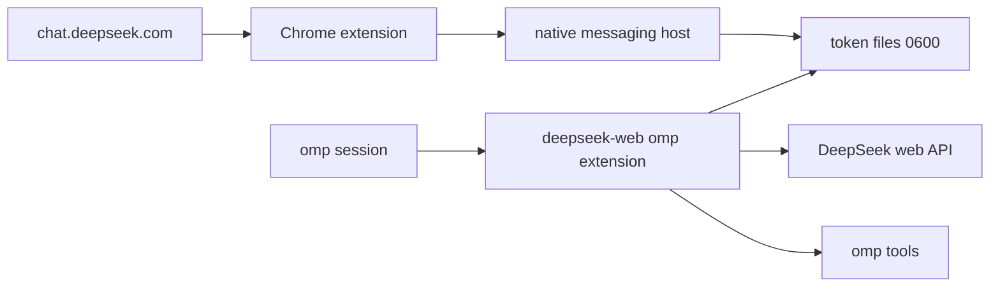

# deepseek-web

Use a free `chat.deepseek.com` web account as an [omp](https://github.com/can1357/oh-my-pi)
provider without running a local proxy.



- `omp-extension/` registers a command-backed `deepseek-web` provider. It calls
  the DeepSeek web API in-process and bridges DSML/V3.1 text tool calls to omp's
  `read`, `edit`, `bash`, and other tools.
- `extension/` is a Chrome MV3 extension. It reads `localStorage.userToken` and
  `deepseek-device-id:chat`, then sends them to a native messaging host.
- `extension/native-host/` writes `~/.omp/agent/deepseek-web-token` and
  `~/.omp/agent/.deepseek-web-device-id` with mode `0600`. There is no HTTP
  listener and no proxy process.

The DeepSeek web API is **unofficial and may change without notice**. Use your
own account and treat this as a personal convenience, not a supported API.

## Requirements

- [Bun](https://bun.sh) 1.x (the only runtime; there are no npm dependencies)
- `omp` 18.x
- A free DeepSeek chat account
- Chrome or another Chromium browser

The native host installer currently writes macOS Chrome-family paths.

## Install

```bash
git clone <this-repo> deepseek-web
cd deepseek-web
bun install
```

There are no runtime dependencies: the provider uses Bun built-ins (`fetch`,
`crypto`, `WebAssembly`) and omp's host packages.

### 1. Install the Chrome bridge

1. Open `chrome://extensions`.
2. Enable **Developer mode**.
3. Click **Load unpacked** and select the `extension/` directory.
4. Copy the extension ID from its card.
5. Install the native host:

   ```bash
   bun extension/install.ts --extension-id <extension-id>
   ```

   Use `--browser chromium|edge|brave` if needed.
6. Reload the extension (or restart Chrome).
7. Open <https://chat.deepseek.com> and sign in normally.

The content script polls every 5 seconds and sends the token only when it
changes. A failed send retries on the next tick. The host writes the files
atomically with owner-only permissions.

Verify the files exist without printing the token:

```bash
test -s ~/.omp/agent/deepseek-web-token && echo token-present
test -s ~/.omp/agent/.deepseek-web-device-id && echo device-present
```

### 2. Load the omp extension

Add the absolute path to `~/.omp/agent/config.yml`:

```yaml
extensions:
  - /absolute/path/to/deepseek-web/omp-extension/index.ts
```

`extensions` replaces the array from lower-precedence settings, so keep any
existing entries in the same list. Alternatively load it per session:

```bash
omp -e /absolute/path/to/deepseek-web/omp-extension/index.ts \
  --model deepseek-web/deepseek-web
```

No `models.yml` provider entry is needed; the extension registers
`deepseek-web/deepseek-web` itself.

### 3. Run

```bash
omp --model deepseek-web/deepseek-web
```

To make it the default, set it in `~/.omp/agent/config.yml`:

```yaml
modelRoles:
  default: deepseek-web/deepseek-web
```

Quick non-interactive check:

```bash
omp --no-extensions \
  -e /absolute/path/to/deepseek-web/omp-extension/index.ts \
  --model deepseek-web/deepseek-web \
  -p "Reply with exactly: OK"
```

Then try "Read README.md and summarize the first section". The `read` tool card
should appear and the model should produce a summary.

## Configuration

The provider currently uses:

- Base URL: `https://chat.deepseek.com`
- Thinking: on by default for tool-less turns. It is automatically disabled when
  tools are present, because DeepSeek web only emits tool calls with thinking off.
- Web search: on by default.
- Set `DEEPSEEK_WEB_THINKING=0` or `DEEPSEEK_WEB_SEARCH=0` to disable either.
- Inputs: text only
- Model metadata: 128k context, 8k output (estimates)

`DEEPSEEK_WEB_TOKEN_CMD` is an optional advanced fallback. When a request gets
`40003 INVALID_TOKEN`, the client can run the command and use its stdout as the
new token. The Chrome bridge normally updates the token first.

To remove the native host:

```bash
bun extension/install.ts --uninstall
```

## Known limitations

- **Unofficial protocol and ToS.** Automated use of free web chat may violate
  DeepSeek's terms or hit rate limits, and endpoints/PoW may change at any time.
  Use at your own risk and with your own account.
- **Buffered streaming.** The provider collects the full upstream response before
  emitting omp events; text does not appear incrementally.
- **Text only.** Images are rejected; the model metadata advertises text input.
- **Tool-call format risk.** DeepSeek web has no native tool calling. The provider
  prompts for DSML (with a V3.1 fallback parser). A hidden prompt or model update
  can break the convention; malformed blocks remain ordinary text. Tool calling
  requires thinking off, so the provider forces thinking off whenever tools are
  present; this is why DeepThink and coding tools cannot be active together.
- **Single account.** One token and one device id are stored. There is no
  multi-account rotation.
- **No usage reporting.** omp sees zero cost/usage; the 128k context window is an
  estimate, not a measured limit.
- **Native host dependency.** The token is read from `localStorage.userToken`.
  If DeepSeek changes that key or the page storage layout, update
  `extension/content.js`. If the repository moves, rerun the installer.

## Vendored PoW solver

`vendor/sha3_wasm_bg.wasm` is required to solve DeepSeek's `DeepSeekHashV1`
challenge.

- Source: `https://fe-static.deepseek.com/chat/static/sha3_wasm_bg.7b9ca65ddd.wasm`
- Size: 26,612 bytes
- SHA-256: `b3fca8cc072c1defbd60c02266a8e48bd307a1804aaff4314900aea720e72f7d`

The file is checked in because the provider loads it from disk instead of
fetching it at runtime. If DeepSeek rotates the asset, verify the new file's hash
and update this section.
