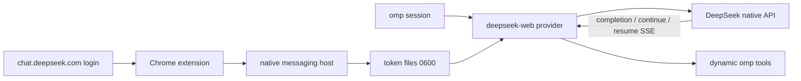

# omp-deepseek-web

Use a free [chat.deepseek.com](https://chat.deepseek.com) account as an
[omp](https://github.com/can1357/oh-my-pi) provider.

The provider runs in-process inside omp. There is no local HTTP proxy, port, or
model gateway. The provider/model id is `deepseek-web/deepseek-web`.

> **Unofficial.** This project is not affiliated with DeepSeek. The web API is
> undocumented and may change without notice. Automated use of free web chat may
> violate DeepSeek's terms or hit rate limits. Use your own account at your own
> risk.

## Features

- `deepseek-web/deepseek-web` model in omp
- Incremental thinking/text streaming with search progress in the status line
- Native recovery through `/api/v0/chat/continue` and
  `/api/v0/chat/resume_stream`
- Native DeepSeek search plus dynamically supplied omp tools
- Persistent native chat sessions for main conversations; task-scoped sessions
  for subagents
- Compact tool protocol: one `tool_calls` marker followed by one JSON object
- Text and image input (PNG, JPEG, WebP, GIF)
- Chrome native-messaging token bridge with owner-only token files
- Shared request pacing and rate-limit retry/cooldown
- Bounded SQLite session store and reset handoff

## Requirements

- [Bun](https://bun.sh) 1.x
- `omp` 18.x
- A free DeepSeek chat account
- Chrome or another Chromium browser for the token bridge

The native-host installer targets macOS Chrome-family paths. On other platforms,
adapt [`extension/install.ts`](./extension/install.ts).

## Architecture



- [`omp-extension/`](./omp-extension): provider, event mapping, session
  strategy, reset handoff, native recovery.
- [`extension/`](./extension): token bridge and native host installer.
- [`src/deepseek/`](./src/deepseek): client, PoW, SSE parser, continuation,
  rate-limit gate.
- [`src/tools/`](./src/tools): tool prompt, compact protocol, parser, renderer.

## Install

### 1. Chrome bridge

From the repository root:

```bash
bun extension/install.ts
# Chromium/Edge/Brave: add --browser chromium|edge|brave
```

Then:

1. Open `chrome://extensions`.
2. Enable **Developer mode**.
3. **Load unpacked** → select `extension/`.
4. Sign in at <https://chat.deepseek.com>.

The extension ID is pinned in `extension/manifest.json`, so no ID copy is
needed. For a custom key, pass `--extension-id <id>` to the installer.

### 2. omp provider

Recommended:

```bash
omp plugin install github:hypn4/omp-deepseek-web
```

Manage it with `omp plugin list`, `omp plugin upgrade omp-deepseek-web`,
`omp plugin disable omp-deepseek-web`, or
`omp plugin uninstall omp-deepseek-web`.

Local development:

```bash
git clone https://github.com/hypn4/omp-deepseek-web.git
cd omp-deepseek-web
bun install
bun test
omp plugin link /path/to/omp-deepseek-web
```

For a one-off run:

```bash
omp -e /path/to/omp-deepseek-web/omp-extension/index.ts \
  --model deepseek-web/deepseek-web
```

### 3. Run

```bash
omp --model deepseek-web/deepseek-web
```

Make it the default in `~/.omp/agent/config.yml`:

```yaml
modelRoles:
  default: deepseek-web/deepseek-web
```

Quick check:

```bash
omp --no-extensions \
  -e /path/to/omp-deepseek-web/omp-extension/index.ts \
  --model deepseek-web/deepseek-web \
  -p "Reply with exactly: OK"
```

## Tool protocol

DeepSeek web has no native function calling, so omp tools use a compact text
protocol:

```text
<｜DSML｜tool_calls>
{"calls":[{"name":"write","arguments":{"path":"/tmp/x","content":"..."}}]}
```

- Only the opening marker is required.
- Arguments are one JSON object, not per-parameter tags.
- There is no closing tag; the parser reads a balanced JSON object.
- Multiple calls share one `calls` array.
- Legacy DSML/DSOL is accepted only for old in-flight sessions. Legacy markup is
  stripped from system, developer, assistant, and handoff history before
  prompting.

## Sessions

`DEEPSEEK_WEB_SESSION_MODE=persistent` is the default:

```text
first turn / reset: full system + tools + transcript
later turns:        only new user/tool messages
                    same chat_session_id + parent_message_id
```

A new native chat is created when any of these changes:

- system prompt or tool schema
- omp compaction, rewind, edit, or branch
- tool protocol version
- transcript prefix mismatch
- failed/aborted turn with no usable response id

The previous native chat is retained. A fresh chat gets a bounded handoff from
the current omp context: cwd, git branch, changed-file names, current request,
and a truncated previous assistant result. It does not read project file
contents or other omp session transcripts. Disable with
`DEEPSEEK_WEB_HANDOFF=off`.

Subagent/task sessions are persistent only for the task lifetime and are deleted
in `session_shutdown`. Title generation uses an ephemeral session. Developer
system reminders are appended incrementally; they do not force a new chat.

Mappings contain only chat/message ids and hashes. They live in
`~/.omp/agent/deepseek-web-sessions.sqlite` with owner-only permissions. The
store is bounded by a 7-day TTL and `DEEPSEEK_WEB_SESSION_MAX_ENTRIES` (1024);
evicted mappings have their native chats deleted best-effort.

Use `DEEPSEEK_WEB_SESSION_MODE=ephemeral` to create and delete a chat per
provider call.

## Configuration

| Variable | Default | Meaning |
| --- | --- | --- |
| `DEEPSEEK_WEB_THINKING` | `1` | Enable DeepThink. |
| `DEEPSEEK_WEB_SEARCH` | `1` | Enable native DeepSeek search. |
| `DEEPSEEK_WEB_PLATFORM` | `android` | Native client platform header. |
| `DEEPSEEK_WEB_CLIENT_VERSION` | `2.6.2` | Native client version header. |
| `DEEPSEEK_WEB_BUNDLE_ID` | `com.deepseek.chat.nov` | Native client bundle id. |
| `DEEPSEEK_WEB_DEVICE_MODEL` | `Android` | Native device-model header. |
| `DEEPSEEK_WEB_CONTEXT_WINDOW` | `1000000` | Direct web API context limit. |
| `DEEPSEEK_WEB_RATE_LIMIT_RETRIES` | `100` | Retries after a rate-limit hint; capped at 100. |
| `DEEPSEEK_WEB_RATE_LIMIT_DELAY_MS` | `10000` | Initial backoff; doubles per retry. |
| `DEEPSEEK_WEB_RATE_LIMIT_MAX_DELAY_MS` | `60000` | Backoff cap; server retry headers are used verbatim. |
| `DEEPSEEK_WEB_MIN_REQUEST_INTERVAL_MS` | `1000` | Minimum spacing between request starts. |
| `DEEPSEEK_WEB_TASK_DELAY_MS` | `3000` | Cooldown after each completed turn. |
| `DEEPSEEK_WEB_SESSION_MODE` | `persistent` | `persistent` or `ephemeral`. |
| `DEEPSEEK_WEB_SESSION_STORE` | `~/.omp/agent/deepseek-web-sessions.sqlite` | SQLite mapping path. |
| `DEEPSEEK_WEB_SESSION_TTL_MS` | `604800000` | Mapping TTL (7 days). |
| `DEEPSEEK_WEB_SESSION_MAX_ENTRIES` | `1024` | Mapping cap; oldest evicted first. |
| `DEEPSEEK_WEB_HANDOFF` | `summary` | Fresh-chat handoff; set `off` to disable. |
| `DEEPSEEK_WEB_TOKEN_CMD` | — | Fallback command that prints a fresh token. |

Auth files:

```text
~/.omp/agent/deepseek-web-token
~/.omp/agent/.deepseek-web-device-id
```

Both are written atomically with mode `0600`.

Remove the native host:

```bash
bun extension/install.ts --uninstall
```

## Security and privacy

- The token moves from the Chrome extension to a local native host, never over a
  network listener.
- The token is never displayed or logged.
- Prompts, images, and tool results are sent to `chat.deepseek.com` for
  inference.
- Persistent mode retains the main native chat; ephemeral mode deletes each
  provider call. Subagent chats are deleted when the task ends.
- Only current-turn images are uploaded; older images are not re-uploaded.

## Limitations

- **Unofficial web API.** Endpoints, PoW, SSE shapes, and tool behavior can
  change.
- **Text tool bridge.** The model can still emit legacy DSML/DSOL. The parser
  normalizes DSOL and falls back for old sessions, but unrecoverable markup
  surfaces as a tool-call failure.
- **Streaming tool calls.** Text/thinking stream incrementally; tool calls are
  parsed after the response completes.
- **Two search paths.** Native DeepSeek search and omp's `web_search` both exist;
  the model chooses.
- **Rate limits are account-level.** Retries use exact server reset headers when
  present, otherwise exponential backoff. Cancellation surfaces as an aborted
  turn; after the retry budget the error includes the attempt count.
- **Context window is the direct web API limit.** Probes accepted 900K tokens
  and rejected prompts above 1M with `context_length_exceeded`. The Android UI
  limit of 61,440 is unrelated to direct API requests.
- **Single account.** One token and device id; no rotation.
- **No usage/cost reporting.** omp sees zero usage/cost.

## Development

```bash
bun test
```

The suite covers transport, SSE, compact/legacy tool parsing, images, provider,
Chrome messaging, rate limits, session store, and native-host protocol.

## Vendored PoW solver

`vendor/sha3_wasm_bg.wasm` solves DeepSeek's `DeepSeekHashV1` challenge.

- Source: `https://fe-static.deepseek.com/chat/static/sha3_wasm_bg.7b9ca65ddd.wasm`
- Size: 26,612 bytes
- SHA-256: `b3fca8cc072c1defbd60c02266a8e48bd307a1804aaff4314900aea720e72f7d`

## Trademarks and license

Unofficial; not affiliated with or endorsed by DeepSeek or Oh My Pi. DeepSeek,
Oh My Pi, Pi, and their logos are trademarks of their owners. See
[NOTICE](./NOTICE). Source is MIT licensed; see [LICENSE](./LICENSE).
