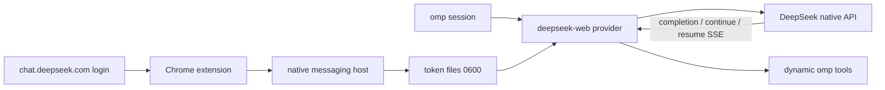

# omp-deepseek-web

Use a free [chat.deepseek.com](https://chat.deepseek.com) account as an
[omp](https://github.com/can1357/oh-my-pi) provider.

The provider runs inside omp as an in-process extension. There is no local HTTP
proxy, port, or model gateway.

The provider and model id remain `deepseek-web/deepseek-web`; only the
repository and plugin package name changed.

> **Unofficial.** This project is not affiliated with DeepSeek. The web API is
> undocumented and may change without notice. Automated use of free web chat may
> violate DeepSeek's terms or hit rate limits. Use your own account and use it at
> your own risk.

## Features

- `deepseek-web/deepseek-web` model in omp
- Incremental thinking/text streaming, with web-search progress in the omp status
  line (`searching…`, `composing…`)
- Native recovery through DeepSeek's `/api/v0/chat/continue` and
  `/api/v0/chat/resume_stream`; no browser or text-heuristic fallback
- Native DeepSeek search and dynamically supplied OMP tools (including
  `web_search`) can be used together
- Persistent native chat sessions for the main conversation: the first turn
  sends the full prompt, later turns send only the new user/tool messages with
  `parent_message_id`
- Task-scoped persistent sessions for subagents; `DEEPSEEK_WEB_SESSION_MODE=ephemeral`
  restores per-turn create/delete behavior
- Keeps the latest user message's language even when search results or tool
  output are in another language
- Text and image input (PNG, JPEG, WebP, GIF)
- omp tools (`read`, `edit`, `write`, `bash`, …) through a marker + JSON
  tool-call protocol
- Chrome native-messaging token bridge with owner-only token files
- No local HTTP server

## Requirements

- [Bun](https://bun.sh) 1.x
- `omp` 18.x
- A free DeepSeek chat account
- Chrome or another Chromium browser for the token bridge

The bundled native-host installer targets macOS Chrome-family paths. On other
platforms, adapt [`extension/install.ts`](./extension/install.ts).

## Architecture



- [`omp-extension/`](./omp-extension) registers the provider, maps omp events,
  handles native completion recovery, and bridges text tool calls. Tool
  definitions come from omp's live context; there is no fixed tool allowlist.
  `conversation.ts` selects the ephemeral or persistent session strategy.
- [`extension/`](./extension) reads the token from the DeepSeek web app and sends
  it to a native messaging host.
- [`extension/native-host/`](./extension/native-host) writes the token and device
  id to `~/.omp/agent` with mode `0600`.
- [`src/deepseek/`](./src/deepseek) contains the native client, PoW solver, SSE
  parser, continuation controller, and stream merge logic.
- [`src/tools/`](./src/tools) contains the dynamic prompt renderer, language
  policy, and tool-call parser.

## Install

Clone the repository and verify the test suite:

```bash
git clone https://github.com/hypn4/omp-deepseek-web.git omp-deepseek-web
cd omp-deepseek-web
bun install
bun test
```

There are no runtime npm dependencies; the provider uses Bun built-ins and omp's
host packages.

### 1. Install the Chrome bridge

The extension ID is pinned in `extension/manifest.json`, so you do not need to
copy it.

1. Install the native host from the repository root:

   ```bash
   bun extension/install.ts
   ```

   For Chromium, Edge, or Brave, add
   `--browser chromium|edge|brave`.

2. Open `chrome://extensions`.
3. Enable **Developer mode**.
4. Click **Load unpacked** and select the `extension/` directory.
5. Open <https://chat.deepseek.com> and sign in normally.

The pinned ID keeps the native host working when the repository moves. If you
build a custom extension with a different key, pass
`--extension-id <id>` to the installer instead.

The extension sends the token only when it changes; a failed send retries on the
next poll. The status badge is `✓` when synced, `…` while syncing, and `!` when a
token or native-host error needs attention. Click the icon to open the status
popup.

### 2. Install the omp provider

**Recommended:** install the published GitHub repository as an omp plugin:

```bash
omp plugin install github:hypn4/omp-deepseek-web
```

This is the primary installation path. The repository is public, so the
GitHub shorthand resolves without extra setup. The plugin manifest loads
`omp-extension/index.ts`, so no `models.yml` entry or manual `extensions:` edit
is required. Manage it with `omp plugin list`,
`omp plugin upgrade omp-deepseek-web`, `omp plugin disable omp-deepseek-web`, or
`omp plugin uninstall omp-deepseek-web`.

For local development from a clone, use `plugin link` instead:

```bash
omp plugin link /path/to/omp-deepseek-web
```

`link` symlinks the working tree and is intended for development; normal users
should use `omp plugin install`.

For one-off development, load the extension explicitly instead:

```bash
omp -e /path/to/omp-deepseek-web/omp-extension/index.ts \
  --model deepseek-web/deepseek-web
```

You can also add the extension path to `~/.omp/agent/config.yml`:

```yaml
extensions:
  - /path/to/omp-deepseek-web/omp-extension/index.ts
```

`extensions` replaces the array from lower-precedence settings, so keep any
existing entries in the same list.

### 3. Run

```bash
omp --model deepseek-web/deepseek-web
```

To make it the default, set:

```yaml
modelRoles:
  default: deepseek-web/deepseek-web
```

Quick non-interactive check:

```bash
omp --no-extensions \
  -e /path/to/omp-deepseek-web/omp-extension/index.ts \
  --model deepseek-web/deepseek-web \
  -p "Reply with exactly: OK"
```

## Session persistence

By default the main omp conversation keeps one native DeepSeek chat session:

```text
first turn:  full system + tools + transcript
             -> create chat_session, save parent response_message_id

later turn:  only new user/tool messages
             -> same chat_session_id + parent_message_id
```

This is safe because the provider verifies that the omp context is an exact
prefix extension. It starts a new chat and sends the full prompt when any of
these changes:

- omp compaction, rewind, edit, or branch
- system prompt or tool schema change
- a turn fails, is aborted, or has no response message id

If a stored native session becomes invalid, that turn fails and its mapping is
invalidated; the next turn starts a fresh full-prompt session. A failed or
aborted later turn never deletes the pre-existing native chat. When the context
changes and the provider starts a fresh mapping, the old native chat is retained
rather than deleted.

Subagent/task sessions use the same strategy only for their own lifetime and are
deleted in `session_shutdown`. Title generation is detected by its prompt and
uses an ephemeral session, so it cannot replace the main chat mapping. Ordinary
tool-less turns still use the persistent strategy. Developer system reminders
(such as edit-rule violations) are sent as incremental `Developer instruction`
updates and do not force a new native chat.

Mappings contain only chat/message ids and hashes; no prompt text or tool output
is stored. They live in a SQLite database at
`~/.omp/agent/deepseek-web-sessions.sqlite` with owner-only directory/file
permissions. The store is bounded by a 7-day TTL and a hard entry cap
(`DEEPSEEK_WEB_SESSION_MAX_ENTRIES`, default 1024). TTL and cap evictions delete
their native chats best-effort; SQLite WAL and incremental vacuum avoid
rewriting the whole store on every turn.

When a fresh native chat is created, the provider appends a bounded session
handoff generated from the current OMP context: cwd, git branch, changed-file
names, the current request, and a truncated previous assistant result. It never
reads project file contents or other OMP session transcripts. Disable this with
`DEEPSEEK_WEB_HANDOFF=off`.

To restore the old behavior:

```bash
DEEPSEEK_WEB_SESSION_MODE=ephemeral
```

In ephemeral mode every provider call creates and deletes its own DeepSeek chat.

## Configuration

| Variable | Default | Meaning |
| --- | --- | --- |
| `DEEPSEEK_WEB_THINKING` | `1` | Enable DeepThink. Set `0` to disable. |
| `DEEPSEEK_WEB_SEARCH` | `1` | Enable native DeepSeek search. OMP tools, including `web_search`, remain dynamically available. Set `0` to disable native search only. |
| `DEEPSEEK_WEB_PLATFORM` | `android` | Native client platform header. |
| `DEEPSEEK_WEB_CLIENT_VERSION` | `2.6.2` | Native client version header. |
| `DEEPSEEK_WEB_BUNDLE_ID` | `com.deepseek.chat.nov` | Native client bundle id header. |
| `DEEPSEEK_WEB_DEVICE_MODEL` | `Android` | Native device-model header. |
| `DEEPSEEK_WEB_CONTEXT_WINDOW` | `1000000` | Direct web API context limit. The model/API documents 1M; prompts above it return `context_length_exceeded`. |
| `DEEPSEEK_WEB_RATE_LIMIT_RETRIES` | `100` | Retry a rate-limit hint only when no text/thinking was emitted; capped at 100. |
| `DEEPSEEK_WEB_RATE_LIMIT_DELAY_MS` | `10000` | Initial backoff; doubles per retry (10s, 20s, 40s, ...). |
| `DEEPSEEK_WEB_RATE_LIMIT_MAX_DELAY_MS` | `60000` | Upper bound for exponential backoff; a server-supplied retry delay is used verbatim. |
| `DEEPSEEK_WEB_MIN_REQUEST_INTERVAL_MS` | `1000` | Minimum spacing between request starts from this process, shared across sessions and tool loops. |
| `DEEPSEEK_WEB_TASK_DELAY_MS` | `3000` | Additional cooldown after each completed turn, including tool-loop turns. Applies before the next request. |
| `DEEPSEEK_WEB_SESSION_MODE` | `persistent` | `persistent` reuses one native chat per omp conversation; `ephemeral` creates and deletes a chat per provider call. |
| `DEEPSEEK_WEB_SESSION_STORE` | `~/.omp/agent/deepseek-web-sessions.sqlite` | Owner-only SQLite mapping database for persistent sessions. |
| `DEEPSEEK_WEB_SESSION_TTL_MS` | `604800000` | Drop unused mappings after 7 days; their native chats are deleted best-effort. |
| `DEEPSEEK_WEB_SESSION_MAX_ENTRIES` | `1024` | Hard cap; the oldest mappings are evicted first and their native chats are deleted. |
| `DEEPSEEK_WEB_HANDOFF` | `summary` | Inject a bounded cwd/git/request handoff when a fresh native chat is created. Set `off` to disable. |
| `DEEPSEEK_WEB_TOKEN_CMD` | — | Advanced fallback command whose stdout is a fresh token after an auth failure. |

The token and device id are stored at:

```text
~/.omp/agent/deepseek-web-token
~/.omp/agent/.deepseek-web-device-id
```

Both files are written atomically with mode `0600`.

To remove the native host:

```bash
bun extension/install.ts --uninstall
```

## Security and privacy

- The token is sent from the Chrome extension to a local native messaging host,
  never over a network listener.
- The token is never displayed in the popup or written to logs.
- Prompts, images, and tool results are sent to `chat.deepseek.com` as part of
  normal inference. Do not use the provider for data you would not share with
  DeepSeek.
- In the default `persistent` mode the main conversation is retained as a
  native DeepSeek chat so later turns can continue it. Use
  `DEEPSEEK_WEB_SESSION_MODE=ephemeral` if you want each provider call deleted
  immediately. Subagent chats are deleted when the task ends.
- Image input uploads the current turn's images to DeepSeek. Older history images
  are not re-uploaded.

## Limitations

- **Unofficial web API.** Endpoints, PoW, response shapes, and tool-call behavior
  can change at any time.
- **Streaming tool calls.** Thinking and answer text stream incrementally, but
  tool calls are emitted after the response completes because the text protocol
  must be parsed as a whole.
- **Two search paths.** Native DeepSeek search is enabled by default, while
  omp's dynamically supplied `web_search` tool remains available. The model may
  choose either; there is no hardcoded preference.
- **Recovery depends on native signals.** The provider follows
  `incomplete_message`/length finish reasons through `/chat/continue`, and
  reconnects an interrupted stream through `/chat/resume_stream`. It does not
  guess truncation from punctuation or sentence shape. If the server reports
  `FINISHED` without an incomplete signal, there is no native continuation to
  invoke; the partial result is surfaced with a length-stop warning.
- **Text tool bridge.** DeepSeek web has no native tool calling. The provider
  uses a single DSML `tool_calls` opening marker followed by one JSON object;
  there are no per-parameter tags or closing tags to corrupt. The parser reads a balanced JSON
  object, and history is replayed in the same format. Legacy DSML/DSOL parsing
  remains only for old in-flight sessions; legacy tool markup is stripped from
  system, developer, assistant, and handoff history before prompting.
- **Images are per-turn.** Uploads and parsing failures surface as the turn
  error. Persistent native history may retain earlier uploaded images according
  to DeepSeek's own retention behavior.
- **Single account.** One token and one device id are stored; there is no
  multi-account rotation.
- **No usage or cost reporting.** omp sees zero usage/cost.
- **Rate limits are account-level.** A rate-limit hint is retried with
  exponential backoff only when no visible text/thinking was emitted. When the
  server supplies `Retry-After` or a rate-limit reset header, that exact delay is
  used; current DeepSeek web responses supply neither, so the configured backoff
  is the fallback (default: 100 retries, 10s doubling capped at 60s). Requests
  are spaced by a shared process-wide gate and enter a cooldown after a limit.
  The status line reports the current retry and delay, and cancellation during a
  wait surfaces as an aborted turn instead of a rate-limit error. After the retry
  budget the provider surfaces an HTTP-429-style error with the attempt count;
  retrying after visible output would duplicate content.
- **Context window is the direct web API limit.** Live probes against
  `/api/v0/chat/completion` accepted a 900K-token prompt and rejected a prompt
  above 1M tokens with `context_length_exceeded`. This matches the official
  DeepSeek-V4.1-Flash-1017 1M model context. The Android app's separate
  `normal_history_and_file_token_limit` default of 61,440 applies to that
  client's history/file UI, not to direct API requests. Older 128K figures
  describe API V3.1/V3.2, not the current web model. Override with
  `DEEPSEEK_WEB_CONTEXT_WINDOW` only when testing a different endpoint.

## Development

```bash
bun test
```

The test suite covers the web transport, SSE parser, tool bridge, image upload,
omp provider, Chrome extension messaging, and native-host protocol.

## Vendored PoW solver

`vendor/sha3_wasm_bg.wasm` solves DeepSeek's `DeepSeekHashV1` proof-of-work
challenge.

- Source: `https://fe-static.deepseek.com/chat/static/sha3_wasm_bg.7b9ca65ddd.wasm`
- Size: 26,612 bytes
- SHA-256: `b3fca8cc072c1defbd60c02266a8e48bd307a1804aaff4314900aea720e72f7d`

## Trademarks

This project is unofficial and is not affiliated with or endorsed by DeepSeek or
Oh My Pi. DeepSeek, the DeepSeek whale logo, Oh My Pi, and Pi are trademarks of
their respective owners. The MIT license covers the source code, not third-party
marks or logo assets. See [NOTICE](./NOTICE).

## License

MIT. See [LICENSE](./LICENSE).
