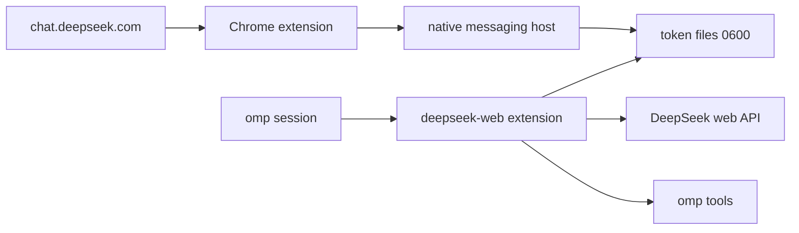

# omp-deepseek-web

Use a free [chat.deepseek.com](https://chat.deepseek.com) account as an
[omp](https://github.com/can1357/oh-my-pi) provider.

The provider runs inside omp as a command-backed extension. There is no local
HTTP proxy, port, or model gateway.

The provider and model id remain `deepseek-web/deepseek-web`; only the
repository and plugin package name changed.

> **Unofficial.** This project is not affiliated with DeepSeek. The web API is
> undocumented and may change without notice. Automated use of free web chat may
> violate DeepSeek's terms or hit rate limits. Use your own account and use it at
> your own risk.

## Features

- `deepseek-web/deepseek-web` model in omp
- Incremental thinking/text streaming, with web-search progress in the omp status
  line (`searching…`, `composing…`)
- Native recovery through DeepSeek's `/api/v0/chat/continue` and
  `/api/v0/chat/resume_stream`; no browser or text-heuristic fallback
- Text and image input (PNG, JPEG, WebP, GIF)
- omp tools (`read`, `edit`, `write`, `bash`, …) through a text tool-call bridge
- Chrome native-messaging token bridge with owner-only token files
- No local HTTP server

## Requirements

- [Bun](https://bun.sh) 1.x
- `omp` 18.x
- A free DeepSeek chat account
- Chrome or another Chromium browser for the token bridge

The bundled native-host installer targets macOS Chrome-family paths. On other
platforms, adapt [`extension/install.ts`](./extension/install.ts).

## Architecture



- [`omp-extension/`](./omp-extension) registers the command-backed provider and
  bridges DeepSeek text tool calls to omp.
- [`extension/`](./extension) reads the token from the DeepSeek web app and sends
  it to a native messaging host.
- [`extension/native-host/`](./extension/native-host) writes the token and device
  id to `~/.omp/agent` with mode `0600`.
- [`src/deepseek/`](./src/deepseek) contains the web transport, PoW solver, and
  SSE parser.
- [`src/tools/`](./src/tools) contains the prompt renderer and tool-call parser.

## Install

Clone the repository and verify the test suite:

```bash
git clone https://github.com/hypn4/omp-deepseek-web.git omp-deepseek-web
cd omp-deepseek-web
bun install
bun test
```

There are no runtime npm dependencies; the provider uses Bun built-ins and omp's
host packages.

### 1. Install the Chrome bridge

The extension ID is pinned in `extension/manifest.json`, so you do not need to
copy it.

1. Install the native host from the repository root:

   ```bash
   bun extension/install.ts
   ```

   For Chromium, Edge, or Brave, add
   `--browser chromium|edge|brave`.

2. Open `chrome://extensions`.
3. Enable **Developer mode**.
4. Click **Load unpacked** and select the `extension/` directory.
5. Open <https://chat.deepseek.com> and sign in normally.

The pinned ID keeps the native host working when the repository moves. If you
build a custom extension with a different key, pass
`--extension-id <id>` to the installer instead.

The extension sends the token only when it changes; a failed send retries on the
next poll. The status badge is `✓` when synced, `…` while syncing, and `!` when a
token or native-host error needs attention. Click the icon to open the status
popup.

### 2. Install the omp provider

**Recommended:** install the published GitHub repository as an omp plugin:

```bash
omp plugin install github:hypn4/omp-deepseek-web
```

> The GitHub shorthand requires public repository access. While this repository
> is private, clone it and use `omp plugin link` below instead. Once the
> repository is public, the command above works without extra setup.

This is the primary installation path. The plugin manifest loads
`omp-extension/index.ts`, so no `models.yml` entry or manual `extensions:` edit
is required. Manage it with `omp plugin list`, `omp plugin upgrade omp-deepseek-web`,
`omp plugin disable omp-deepseek-web`, or
`omp plugin uninstall omp-deepseek-web`.

For local development from a clone, use `plugin link` instead:

```bash
omp plugin link /path/to/omp-deepseek-web
```

`link` symlinks the working tree and is intended for development; normal users
should use `omp plugin install`.

For one-off development, load the extension explicitly instead:

```bash
omp -e /path/to/omp-deepseek-web/omp-extension/index.ts \
  --model deepseek-web/deepseek-web
```

You can also add the extension path to `~/.omp/agent/config.yml`:

```yaml
extensions:
  - /path/to/omp-deepseek-web/omp-extension/index.ts
```

`extensions` replaces the array from lower-precedence settings, so keep any
existing entries in the same list.

### 3. Run

```bash
omp --model deepseek-web/deepseek-web
```

To make it the default, set:

```yaml
modelRoles:
  default: deepseek-web/deepseek-web
```

Quick non-interactive check:

```bash
omp --no-extensions \
  -e /path/to/omp-deepseek-web/omp-extension/index.ts \
  --model deepseek-web/deepseek-web \
  -p "Reply with exactly: OK"
```

## Configuration

| Variable | Default | Meaning |
| --- | --- | --- |
| `DEEPSEEK_WEB_THINKING` | `auto` | `auto` disables DeepThink when tools are advertised (native tool mode) and enables it otherwise. `1`/`0` force it. |
| `DEEPSEEK_WEB_SEARCH` | `1` | Enable web search. Set `0` to disable. |
| `DEEPSEEK_WEB_PLATFORM` | `android` | Native client platform header. |
| `DEEPSEEK_WEB_CLIENT_VERSION` | `2.6.2` | Native client version header. |
| `DEEPSEEK_WEB_BUNDLE_ID` | `com.deepseek.chat.nov` | Native client bundle id header. |
| `DEEPSEEK_WEB_DEVICE_MODEL` | `Android` | Native device-model header. |
| `DEEPSEEK_WEB_TOKEN_CMD` | — | Advanced fallback command whose stdout is a fresh token after an auth failure. |

The token and device id are stored at:

```text
~/.omp/agent/deepseek-web-token
~/.omp/agent/.deepseek-web-device-id
```

Both files are written atomically with mode `0600`.

To remove the native host:

```bash
bun extension/install.ts --uninstall
```

## Security and privacy

- The token is sent from the Chrome extension to a local native messaging host,
  never over a network listener.
- The token is never displayed in the popup or written to logs.
- Prompts, images, and tool results are sent to `chat.deepseek.com` as part of
  normal inference. Do not use the provider for data you would not share with
  DeepSeek.
- Image input uploads the current turn's images to DeepSeek. Older history images
  are not re-uploaded.

## Limitations

- **Unofficial web API.** Endpoints, PoW, response shapes, and tool-call behavior
  can change at any time.
- **Streaming tool calls.** Thinking and answer text stream incrementally, but
  tool calls are emitted after the response completes because the text protocol
  must be parsed as a whole.
- **Recovery depends on native signals.** The provider follows
  `incomplete_message`/length finish reasons through `/chat/continue`, and
  reconnects an interrupted stream through `/chat/resume_stream`. It does not
  guess truncation from punctuation or sentence shape. If the server reports
  `FINISHED` without an incomplete signal, there is no native continuation to
  invoke; the partial result is surfaced with a length-stop warning.
- **Text tool bridge.** DeepSeek web has no native tool calling. Tool calls are
  parsed from a prompted format and can break if the model or hidden system
  prompt changes.
- **Images are per-turn.** Uploads and parsing failures surface as the turn
  error.
- **Single account.** One token and one device id are stored; there is no
  multi-account rotation.
- **No usage or cost reporting.** omp sees zero usage/cost, and context limits
  are estimates.

## Development

```bash
bun test
```

The test suite covers the web transport, SSE parser, tool bridge, image upload,
omp provider, Chrome extension messaging, and native-host protocol.

## Vendored PoW solver

`vendor/sha3_wasm_bg.wasm` solves DeepSeek's `DeepSeekHashV1` proof-of-work
challenge.

- Source: `https://fe-static.deepseek.com/chat/static/sha3_wasm_bg.7b9ca65ddd.wasm`
- Size: 26,612 bytes
- SHA-256: `b3fca8cc072c1defbd60c02266a8e48bd307a1804aaff4314900aea720e72f7d`

## Trademarks

This project is unofficial and is not affiliated with or endorsed by DeepSeek or
Oh My Pi. DeepSeek, the DeepSeek whale logo, Oh My Pi, and Pi are trademarks of
their respective owners. The MIT license covers the source code, not third-party
marks or logo assets. See [NOTICE](./NOTICE).

## License

MIT. See [LICENSE](./LICENSE).
